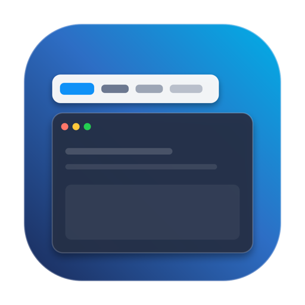

<p align="center">
  
</p>

<h1 align="center">MenuTogether</h1>

<p align="center">
  <strong>Mantém a barra de menu do aplicativo ativo acoplada acima da janela em foco no macOS.</strong><br/>
  Ideal para monitores grandes e setups multi-monitor onde a barra superior do Mac fica distante da janela em uso.
</p>

<p align="center">
  
  
  
</p>

---

## Visão Geral / Overview

Em monitores grandes (4K, Ultrawide, TVs de 40"–55"+), a barra de menus nativa do macOS fica no topo extremo da tela, obrigando o cursor a percorrer grandes distâncias sempre que você precisa acionar um menu de uma janela menor.

O **MenuTogether** resolve isso exibindo uma versão compacta, translúcida e nativa da barra de menus **colada diretamente acima da borda superior da janela em foco**, sem roubar o foco da janela ativa e desaparecendo automaticamente quando não é necessária.

### Principais Recursos

- **Menu Acoplado em Tempo Real**: Lê a hierarquia completa da barra de menus (`AXMenuBar`), submenus, estados habilitados/desabilitados e atalhos de teclado do aplicativo ativo via API de Acessibilidade do macOS e executa as ações nativamente (`AXPress`).
- **Regra Inteligente dos 80% & Tela Cheia**: Quando a janela ocupa mais de **80% da área/altura visível da tela** (ajustável entre 50% e 95%) ou entra em **Tela Cheia**, o menu acoplado desaparece automaticamente, mantendo apenas a barra superior padrão do macOS.
- **Proteção Total dos Botões da Janela**: Se a janela estiver encostada no topo do monitor (sem espaço livre entre a barra de título e a barra do sistema), o menu acoplado se oculta imediatamente para **nunca** cobrir os botões de fechar, minimizar ou maximizar.
- **Seletor Multi-Monitor Inteligente**: Escolha exatamente em quais monitores o MenuTogether deve funcionar. Monitores pequenos (< 18", como telas integradas de 13" ou displays portáteis) são detectados e podem ficar desativados automaticamente enquanto monitores grandes permanecem ativos.
- **Ativação/Desativação Instantânea (`⌃⌥⌘M`)**: Alterne o recurso a qualquer momento pelo atalho global **`Control + Option + Command + M`** ou com 1 clique no ícone da barra de status.
- **Painel Integrado aos Ajustes do Sistema (`MenuTogether.prefPane`)**: Inclui tanto uma janela própria de configurações quanto um painel nativo instalado em `~/Library/PreferencePanes/MenuTogether.prefPane` para acesso direto nos **Ajustes do Sistema** do Mac.

---

## Estrutura do Projeto

```text
MenuTogether/
├── Assets/
│   ├── AppIcon.icns                     # Ícone nativo macOS (.icns)
│   ├── AppIcon-512.png                  # Preview de alta resolução
│   └── AppIcon-128.png                  # Ícone do painel de Ajustes do Sistema
├── PrefPane/
│   └── MenuTogetherPrefPane.swift       # Painel nativo para os Ajustes do Sistema (.prefPane)
├── Sources/MenuTogether/
│   ├── main.swift                       # AppDelegate, Menu da Barra de Status e ciclo de vida
│   ├── AppSettings.swift                # Persistência, detecção física de monitores (polegadas) e sincronização
│   ├── AXHelper.swift                   # Leitura de menus via Accessibility API e cálculo de limites de tela
│   ├── AttachedMenuPanel.swift          # NSPanel flutuante não-ativador com NSVisualEffectView
│   ├── WindowTracker.swift              # Rastreamento em tempo real (AXObserver + sincronização de movimento)
│   ├── GlobalHotKeyManager.swift        # Registro do atalho global ⌃⌥⌘M via Carbon EventHotKey
│   └── SettingsWindowController.swift   # Interface SwiftUI de ajustes finos e seleção de monitores
├── scripts/
│   └── generate_icon.swift              # Gerador vetorial CoreGraphics do ícone do aplicativo
├── Package.swift                        # Manifesto Swift Package Manager
└── build_app.sh                         # Script completo de build, assinatura e instalação
```

---

## Como Compilar e Instalar

### Pré-requisitos
- **macOS 13.0 (Ventura)** ou superior
- **Swift 5.9+** / Command Line Tools (`xcode-select --install`)

### Passo a Passo

1. Clone o repositório e execute o script de compilação:
   ```bash
   git clone https://github.com/dansorrel/MenuTogether.git
   cd MenuTogether
   ./build_app.sh
   ```

2. O script `build_app.sh` irá automaticamente:
   - Gerar os ícones (`Assets/AppIcon.icns`) caso ainda não existam;
   - Compilar o binário otimizado em modo **Release** e empacotar o `MenuTogether.app`;
   - Compilar e instalar o painel **`MenuTogether.prefPane`** em `~/Library/PreferencePanes/`;
   - Assinar digitalmente (`codesign` ad-hoc) os pacotes e iniciar o `MenuTogether.app`.

3. **Permissão de Acessibilidade**:
   - Na primeira abertura, conceda permissão ao **MenuTogether** em:
     **Ajustes do Sistema → Privacidade e Segurança → Acessibilidade**.

---

## Controles e Ajustes Finos

Você pode abrir as configurações clicando no ícone do **MenuTogether** na barra de menu superior ou abrindo os **Ajustes do Sistema**:

| Configuração | Padrão | Descrição |
| :--- | :--- | :--- |
| **Atalho Global** | `⌃⌥⌘M` | Ativa ou pausa o menu acoplado instantaneamente em qualquer aplicativo. |
| **Monitores Habilitados** | Monitores `> 18"` | Ativa/desativa o recurso individualmente por monitor conectado (exibe diagonal em polegadas e resolução). |
| **Limite de Uso da Tela** | `80%` | Oculta o menu acoplado quando a janela ocupa mais que a porcentagem definida da área/altura da tela. |
| **Distância Vertical** | `2 pt` | Espaçamento em pontos acima da borda superior da janela em foco (`0 pt` a `16 pt`). |
| **Deslocamento Horizontal** | `0 pt` | Recuo horizontal a partir da borda esquerda da janela (`0 pt` a `120 pt`). |

---

## Licença

Distribuído sob a licença **MIT**. Veja o arquivo [LICENSE](LICENSE) para mais detalhes.
